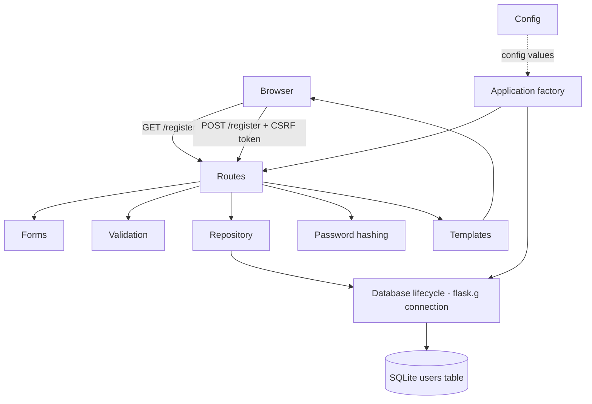
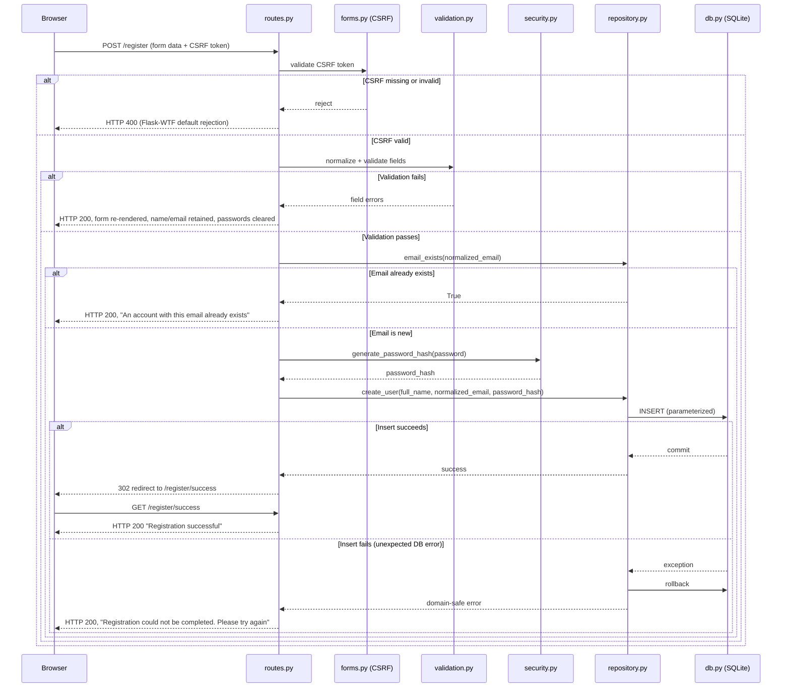

# Architecture — REG-1 User Registration

| Field | Value |
|---|---|
| Artifact | Architecture |
| SDLC Step | 2. Architecture |
| Source | `docs/01-requirements.md` (Approved) |
| Author Role | Solution Architect (Copilot agent) |
| Commit | Pending before commit |
| Date | 2026-10-16 |
| Status | Approved |

## 1. Design Goals Mapped to NFR IDs

| Design goal | NFR IDs |
|---|---|
| Run on a supported Python runtime with no unapproved dependency beyond Flask-WTF | NFR-1 |
| Never let a plain-text password reach storage, logs, or HTTP output | NFR-2 |
| Keep Jinja auto-escaping enabled everywhere user data is rendered | NFR-3 |
| Keep `/register` GET response time low enough for the server-side performance test | NFR-4 |
| Keep modules small and independently testable to reach 85% coverage | NFR-5 |
| Keep all test databases under `tmp_path`, with no network calls | NFR-6 |
| Scope one SQLite connection per request context, opened lazily and torn down deterministically | NFR-7 |
| Keep Selenium tests isolated to one supported, headless browser | NFR-8 |

## 2. Component Table

| Component | Proposed file | Responsibility | Depends on | Requirement IDs |
|---|---|---|---|---|
| Application factory | `src/registration_app/app.py` | Create and configure the Flask app: register blueprint, CSRF, config, teardown hooks | Configuration, Registration blueprint, Database lifecycle | FR-15, NFR-1, NFR-7 |
| Configuration | `src/registration_app/config.py` | Hold `SECRET_KEY`, `DATABASE_PATH`, `WTF_CSRF_ENABLED`, `TESTING`, `DEBUG=False`, `MAX_CONTENT_LENGTH` sourced from environment/injected config | None | NFR-1, SEC-8 |
| Registration route (blueprint) | `src/registration_app/routes.py` | Handle GET `/register` (render form), POST `/register` (orchestrate validation → repository → redirect), GET `/register/success` (render success page) | Forms, Validation, Repository | FR-1, FR-2, FR-4, FR-5, FR-6, FR-15 |
| Forms (CSRF boundary) | `src/registration_app/forms.py` | Define `RegistrationForm(FlaskForm)` carrying the CSRF token and raw field declarations only; no business rules | Flask-WTF | FR-15, SEC-4 |
| Validation | `src/registration_app/validation.py` | Pure functions: trim/normalize inputs, enforce length limits, email format, full-name character policy, password strength, confirmation match; return structured field errors | None (pure, no Flask/DB import) | FR-5, FR-7, FR-8, FR-9, FR-12, FR-13, FR-14 |
| Password hashing | `src/registration_app/security.py` | Thin wrapper around Werkzeug `generate_password_hash` / `check_password_hash` | Werkzeug | FR-3, SEC-1 |
| Database lifecycle | `src/registration_app/db.py` | Open one `sqlite3.Connection` per request lazily via `flask.g`, apply schema on first use, close on `teardown_appcontext` | sqlite3, Configuration | NFR-7, SEC-6 |
| Repository | `src/registration_app/repository.py` | `email_exists(connection, normalized_email)`, `create_user(connection, full_name, normalized_email, password_hash)`; receives an explicit `sqlite3.Connection` parameter (dependency injection) rather than importing `get_db()` internally, so it can be unit-tested directly against a `tmp_path` connection without a Flask application context; parameterized SQL only; commits on success, rolls back and raises a domain-safe `RepositoryError` on failure | Database lifecycle | FR-2, FR-10, FR-11, SEC-2, SEC-3, SEC-6 |
| Templates and static assets | `src/registration_app/templates/register.html`, `templates/success.html`, `static/css/style.css` | Render form, field errors, and success page through Jinja auto-escaping; `register.html` must render the CSRF hidden field (`{{ form.hidden_tag() }}` or `{{ form.csrf_token }}`) inside the `<form>` element so legitimate submissions are not rejected; no inline business logic | Registration route | FR-1, FR-4, FR-15, FR-16, NFR-3 |

Eight production components, consistent with the "approximately six to eight modules" constraint.

## 3. Component / Data-Flow Diagram



## 4. Registration POST Sequence



## 5. SQLite User Schema

```sql
CREATE TABLE IF NOT EXISTS users (
    id INTEGER PRIMARY KEY AUTOINCREMENT,
    full_name TEXT NOT NULL,
    email TEXT NOT NULL UNIQUE,
    password_hash TEXT NOT NULL,
    created_at TEXT NOT NULL DEFAULT (datetime('now'))
);
```

Notes:

- `email` stores the already-normalized (trimmed, lowercased) value, so the SQLite `UNIQUE`
  constraint enforces the same case-insensitive uniqueness rule the application checks
  (FR-10, SEC-2).
- `full_name` stores the trimmed Unicode value as submitted; display is always through Jinja
  auto-escaping (FR-16).
- `password_hash` stores only the Werkzeug hash output; never the plain password (FR-3, SEC-1).
- Schema is created idempotently (`CREATE TABLE IF NOT EXISTS`) the first time a connection is
  opened against a given database file, so tests under `tmp_path` and the real `instance/`
  database both self-initialize.

## 6. Security Design

| Concern | Design decision | Requirement IDs |
|---|---|---|
| Password storage | `security.py` calls `generate_password_hash`/`check_password_hash` only; no custom hashing | SEC-1, FR-3 |
| Email uniqueness | Two layers: `repository.email_exists()` lookup before insert, and SQLite `UNIQUE` constraint on `email` as a concurrency-safe backstop; a `sqlite3.IntegrityError` from the constraint is caught in `repository.py` and converted to the duplicate-email outcome | SEC-2, FR-10 |
| SQL injection | All queries in `repository.py` use `?` placeholders; no f-strings/`.format()`/concatenation with user input | SEC-3, EC-18 |
| CSRF | Flask-WTF `CSRFProtect` initialized in the application factory; `RegistrationForm` carries the token; real configuration always enables it; tests may set `WTF_CSRF_ENABLED=False` only via explicit test config | SEC-4, FR-15, EC-15, EC-16 |
| XSS | All templates use default Jinja auto-escaping; no `|safe`/`Markup` applied to submitted values; full-name field is escaped identically whether it contains normal Unicode text or script-shaped input | SEC-5, FR-16, EC-17 |
| Database-error safety | `repository.create_user()` must catch `sqlite3.IntegrityError` **before** the broader `sqlite3.Error`: an `IntegrityError` on the `email` unique constraint always routes to the duplicate-email outcome (not the generic failure message), while any other `sqlite3.Error` rolls back and raises an internal `RepositoryError` carrying no SQL/text/path; `routes.py` catches `RepositoryError` and renders only the generic message | SEC-6, FR-10, FR-11, EC-12, EC-13, EC-14 |
| Password-field retention | `routes.py` never passes `password`/`confirm_password` back into the template context on any failure path; only `full_name` and `email` are passed back | SEC-7, FR-6 |
| Secret configuration | `config.py` reads `SECRET_KEY` and `DATABASE_PATH` from environment variables with no committed default secret; `.env.example` holds only empty placeholders | SEC-8 |
| Debug/traceback safety | `config.py` sets `DEBUG=False` in every non-test configuration so Flask never returns an interactive traceback page; application-level exception handling logs only the exception class name and a static safe message, never the raw form data, exception arguments, submitted password, or CSRF token | SEC-6, NFR-2 |
| Request-size limiting | `config.py` sets `MAX_CONTENT_LENGTH` (for example 16 KB) so Flask rejects an oversized request body with HTTP 413 before it reaches `validation.py`, rather than relying solely on post-parse length checks | FR-14, NFR-5 |

## 7. Validation Strategy

`validation.py` is a pure module (no Flask or database imports) so it can be unit-tested in
isolation and reused by both the route and future tests.

Processing order for a submitted form:

1. Trim `full_name` and `email`; lowercase the trimmed `email`. Leave `password` and
   `confirm_password` untouched (FR-12).
2. Check required fields: reject if `full_name` (post-trim) or `email` (post-trim) or
   `password` or `confirm_password` is empty, producing one message per missing field
   (FR-5).
3. Validate `full_name`: reject whitespace-only values, reject Unicode control characters
   (category `Cc`), enforce the 100-character limit after trimming (FR-13, FR-14, EC-1–EC-5).
4. Validate `email` format using a practical RFC-5322-subset regex (local-part@domain, at
   least one `.` in the domain, no whitespace), enforce the 254-character limit after
   trimming (FR-7, FR-14, EC-6, EC-7).
5. Validate `password`: length 8–128, at least one uppercase, one lowercase, one digit
   (FR-9, FR-14, EC-8–EC-11).
6. Validate `confirm_password`: length ≤128, must equal `password` exactly (FR-8, FR-14).
7. Return a structured result: normalized values plus a dict of field → message(s).

The route only calls this module, applies the returned normalized values, and — if there are
no errors — proceeds to the repository lookup/insert. The route never implements a validation
rule itself (per architecture constraints).

## 8. Database and Transaction Lifecycle

- `db.py` exposes `get_db()`, which opens a `sqlite3.Connection` on first call within the
  current application/request context and stores it on `flask.g`; subsequent calls in the
  same context reuse it (NFR-7).
- `get_db()` applies the schema (`CREATE TABLE IF NOT EXISTS users ...`) once per connection
  open, so no separate migration step is required for this story's scope.
- `close_db()` is registered via `app.teardown_appcontext` and closes the connection if one
  was opened, regardless of whether the request succeeded or failed.
- `repository.create_user()` performs the `INSERT`, calls `connection.commit()` only after a
  successful execute, and uses an exception-handling order of `except sqlite3.IntegrityError`
  (duplicate-email outcome) **then** `except sqlite3.Error` (rollback and re-raise as
  `RepositoryError`) (FR-10, FR-11, SEC-6).
- `repository.email_exists()` and `repository.create_user()` both receive the active
  `sqlite3.Connection` as an explicit parameter from `routes.py` (which obtains it from
  `db.get_db()`); the repository module never imports or calls `get_db()` itself, so
  repository unit tests can pass in a `tmp_path` connection directly without a Flask
  application/request context (NFR-5, testability).
- `repository.email_exists()` performs a read-only `SELECT` and does not commit or roll back.
- Tests construct the app with a `DATABASE_PATH` pointing at a file under pytest `tmp_path`,
  so production and tests never share a database file (NFR-6).

## 9. Error-Handling Strategy Mapped to EC IDs

| EC ID | Handling layer | Behavior |
|---|---|---|
| EC-1, EC-2, EC-3 | `validation.py` | Rejected with a full-name-specific message; no repository call made |
| EC-4, EC-5 | `validation.py` | Length boundary enforced exactly at 100/101 characters after trim |
| EC-6, EC-7 | `validation.py` | Length boundary enforced exactly at 254/255 characters after trim |
| EC-8, EC-9, EC-10 | `validation.py` | Length boundary enforced exactly at 8/128/129 characters |
| EC-11 | `validation.py` | Each missing character class produces a password-rule message |
| EC-12, EC-13 | `repository.py` via `email_exists()` on the normalized value (pre-insert lookup), and via a caught `sqlite3.IntegrityError` on the `email` unique constraint (concurrent-insert backstop) | Duplicate-email message in both cases; no second account row persists |
| EC-14 | `repository.py` via caught `sqlite3.Error` (excluding `IntegrityError`, handled above) → rollback → `RepositoryError`; `routes.py` catches `RepositoryError` | Generic database-failure message only; no partial row persists |
| EC-15, EC-16 | Flask-WTF `CSRFProtect` (before the route body executes) | Request rejected by Flask-WTF's standard handling; no validation or repository code runs |
| EC-17 | `templates/register.html` / `templates/success.html` via Jinja auto-escaping | Rendered as escaped text; no script execution |
| EC-18 | `repository.py` parameterized queries | Value bound as data; no injection effect |
| EC-19 | `routes.py` POST-Redirect-GET pattern | A refreshed success page re-issues the GET only, never resubmits the POST |

## 10. Testing Strategy

| Layer | Location | Approach |
|---|---|---|
| Validation unit tests | `tests/test_validation.py` | Call pure functions directly; cover every rule and boundary in Sections 7 and 9 |
| Security unit tests | `tests/test_security.py` | Verify hash differs from plain password and `check_password_hash` round-trips |
| Repository tests | `tests/test_repository.py` | Use a `tmp_path` SQLite file; cover insert, lookup, duplicate constraint, commit, rollback, connection cleanup, SQL-injection-shaped input |
| Flask integration tests | `tests/test_routes.py` | Use Flask test client against an app built with a `tmp_path` database; cover every scenario listed in the `python-test-standards` skill's "Required Flask integration tests" |
| CSRF tests | `tests/test_csrf.py` | Valid token accepted, missing token rejected, invalid token rejected |
| Performance test | `tests/test_performance.py` (`@pytest.mark.performance`) | 1 warm-up GET + 5 measured GETs to `/register`; assert HTTP 200 and median < 2.0s; documents server-side-only scope (NFR-4) |
| Selenium UI tests | `tests/ui/test_registration_ui.py` (`@pytest.mark.ui`) | Headless Chrome; happy path and mismatched-password path per the skill's minimum/recommended scenarios (NFR-8) |
| Coverage | CI/local | `python -m pytest --cov=src/registration_app --cov-report=term-missing`; target ≥85% (NFR-5) |

## 11. Technology Decisions and Rejected Alternatives

| Decision | Chosen | Rejected alternative | Rationale |
|---|---|---|---|
| CSRF | Flask-WTF `CSRFProtect` (approved new dependency) | Hand-rolled session-token CSRF check | Security-critical code should use a vetted, maintained implementation rather than custom cryptographic/token logic (per security baseline: never implement security primitives manually) |
| ORM | None — built-in `sqlite3` with a thin repository module | SQLAlchemy | Explicitly disallowed without human approval; the story's single-table scope does not need an ORM |
| Email format check | Practical regex in `validation.py` (no new dependency) | `email-validator` package | Avoids an additional runtime dependency for a single, narrow format check; regex is unit-tested directly against required cases |
| Form library | `FlaskForm` from Flask-WTF used only for the CSRF token and raw field declarations | WTForms built-in validators for business rules | Keeps business validation in a plain, dependency-free, directly-unit-testable module (`validation.py`) per the "keep validation separate from the route" constraint, while still reusing Flask-WTF for the CSRF boundary already required |
| Connection scope | One connection per app/request context via `flask.g` | A module-level global connection or a connection pool | Matches the approved requirement (NFR-7) and keeps test isolation simple with `tmp_path` |

## 12. Open Design Questions

- Exact email-format regex pattern: a practical subset will be finalized during implementation
  and fully unit-tested; no external validation service will be used. **Not Decided** beyond
  this constraint — to be fixed in `validation.py` during Step 5 and reviewed in Step 6.
- Exact set of "normal punctuation" characters permitted in Full Name: implementation rejects
  only Unicode category `Cc` (control characters), matching FR-13 exactly. No broader category
  (such as `Cf` format characters) is excluded unless the human explicitly approves a scope
  change; this was narrowed during Step 3 design review (see `docs/03-design-review.md`, DR-4).
- Logging format/destination for internal database errors (EC-14): logging configuration
  (handler, level, rotation) is deferred to implementation, but the logging policy itself is
  fixed by this architecture — see "Debug/traceback safety" in Section 6.

## 13. Requirement-Coverage Matrix

| Requirement ID | Component(s) |
|---|---|
| FR-1 | Registration route, Templates |
| FR-2 | Registration route, Repository |
| FR-3 | Password hashing |
| FR-4 | Registration route, Templates |
| FR-5 | Validation, Registration route |
| FR-6 | Registration route |
| FR-7 | Validation |
| FR-8 | Validation |
| FR-9 | Validation |
| FR-10 | Repository |
| FR-11 | Repository, Database lifecycle |
| FR-12 | Validation |
| FR-13 | Validation |
| FR-14 | Validation |
| FR-15 | Forms, Application factory |
| FR-16 | Templates |
| NFR-1 | Application factory, Configuration |
| NFR-2 | Password hashing, Registration route |
| NFR-3 | Templates |
| NFR-4 | Registration route (no design element slows GET `/register`) |
| NFR-5 | All components (testability by design) |
| NFR-6 | Database lifecycle, test architecture |
| NFR-7 | Database lifecycle |
| NFR-8 | Test architecture (Selenium) |

## 14. Revision History

| Revision | Date | Trigger | Summary of change |
|---|---|---|---|
| 1 | 2026-10-16 | Step 3 design review (`docs/03-design-review.md`) | Applied accepted corrections DR-1–DR-6: added debug/traceback and request-size-limiting rows to Section 6; specified `IntegrityError`-before-`Error` exception ordering in Sections 6, 8 and 9 for the duplicate-email race condition; added the CSRF hidden-field requirement to the Templates component and Section 6; changed the Repository component and Section 8 to receive an explicit `sqlite3.Connection` parameter instead of calling `get_db()` internally; narrowed the Full Name control-character policy in Section 12 to Unicode category `Cc` only, removing the unapproved `Cf` extension. |

---

**Gate:** Approve step 2 and continue? (yes / changes needed)
