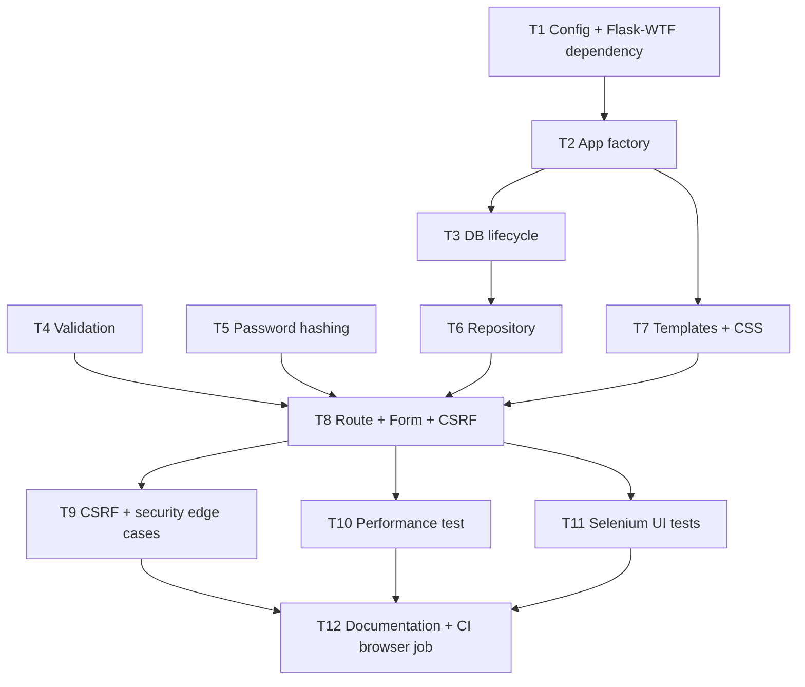

# Implementation Plan — REG-1 User Registration

| Field | Value |
|---|---|
| Artifact | Implementation Plan |
| SDLC Step | 4. Implementation Plan |
| Source | `docs/01-requirements.md` (Approved), `docs/02-architecture.md` (Approved, Revision 1), `docs/03-design-review.md` (Approved with conditions) |
| Author Role | Implementation Planner (Copilot agent) |
| Commit | Pending before commit |
| Date | 2026-10-16 |
| Status | Approved |

## 1. Plan Summary

Twelve small, dependency-ordered tasks (T1–T12) implement the approved architecture,
including all six design-review corrections (ADD-1–ADD-6). Each production task ships its
own tests in the same task, following the preferred dependency order: configuration →
database lifecycle → validation → password hashing → repository → templates → route/CSRF
integration → security/edge-case tests → performance test → Selenium → documentation and a
dedicated CI browser job. T12 was expanded (not split into a new task) to include a dedicated
GitHub Actions `browser-tests` job, since the existing CI quality gate filters with
`-m "not ui"` and would otherwise never run T11's Selenium tests. T12 is now explicitly
blocked by T11. Every task is scoped for one human approval cycle (`Approve <task-id> and
continue?`).

## 2. Actual Existing-File Inventory

Inspected before naming any file in this plan:

| Path | State |
|---|---|
| `src/registration_app/__init__.py` | Exists — package docstring and `__version__` only |
| `src/registration_app/static/` | Exists — empty directory |
| `src/registration_app/templates/` | Exists — empty directory |
| `tests/.gitkeep` | Exists |
| `tests/ui/` | Exists — empty directory |
| `pyproject.toml` | Exists — dependencies currently list only `Flask>=3.1,<4.0`; `Flask-WTF` is **not yet listed** and must be added (architecture-approved new dependency) |
| `.env.example` | Exists — already has `FLASK_SECRET_KEY`, `REGISTRATION_DATABASE`, `FLASK_DEBUG` placeholders, consistent with the planned `config.py` |
| `.github/workflows/ci.yml` | Exists — runs `scripts/quality_gate.py` (ruff + non-UI pytest, since `quality_gate.py` filters with `-m "not ui"`) and `pip-audit`; **requires a change**: no job currently runs the `@pytest.mark.ui` Selenium tests created in T11, so this workflow must gain a dedicated browser job (see T12) |
| `scripts/quality_gate.py` | Exists — runs `ruff check .` then `pytest -q -m "not ui"` only if test files exist; no change required |
| `scripts/pre_commit_check.py` | Exists — blocks `.env`, databases, keys, secret-shaped content; no change required |
| `README.md` | Exists — "Status" section still says "Repository scaffold only"; will need updating once implementation is complete |
| `CHANGELOG.md` | Exists — `[Unreleased]` section has scaffold-only entries; will need updating |
| `main.py` | Exists — unrelated PyCharm sample script at repository root; not part of `src/registration_app` and is not touched by this plan |
| No file named `app.py`, `config.py`, `db.py`, `validation.py`, `security.py`, `repository.py`, `forms.py`, or `routes.py` exists yet under `src/registration_app/` | All are new |
| No file named `register.html`, `success.html`, or `style.css` exists yet | All are new |
| No test file (`test_*.py`) exists yet under `tests/` | All are new |

## 3. Dependency-Ordered Task Table

| ID | Task | Files | Requirement and decision IDs | Blocked by | Done criteria |
|---|---|---|---|---|---|
| T1 | Add the Flask-WTF dependency and create the configuration module | `pyproject.toml` (modify: add `Flask-WTF>=1.2,<2.0` to `dependencies`); `src/registration_app/config.py` (new); `tests/test_config.py` (new) | NFR-1, SEC-8, ADD-1, ADD-6, FR-15 | None | `Config` (and a `TestConfig` override) expose `SECRET_KEY`, `DATABASE_PATH`, `WTF_CSRF_ENABLED`, `TESTING`, `DEBUG=False`, `MAX_CONTENT_LENGTH` (16 KB); values are read from environment variables with safe defaults only for non-secret fields; `python -m pytest -q tests/test_config.py` and `ruff check .` both pass |
| T2 | Create the application-factory skeleton | `src/registration_app/app.py` (new); `tests/test_app.py` (new) | FR-15, NFR-1, ADD-1 | T1 | `create_app(test_config=None)` builds a Flask app from `Config`, applies an optional test-config override, and initializes `CSRFProtect`; no blueprint registered yet; tests confirm the factory returns a configured `Flask` instance and that `TESTING`/`WTF_CSRF_ENABLED` can be overridden; confirm `create_app()` has no parameter, environment variable, or code path that allows `TestConfig` to be selected other than an explicit direct call from test fixtures; add a test proving the default factory call never produces `TestConfig` behavior (CSRF remains enabled, `SECRET_KEY` is not the literal test value); `pytest -q tests/test_app.py` and `ruff check .` pass |
| T3 | Implement the SQLite schema and per-request connection lifecycle | `src/registration_app/db.py` (new); `src/registration_app/app.py` (modify: register `teardown_appcontext(close_db)`); `tests/test_db.py` (new) | NFR-6, NFR-7, SEC-6 | T2 | `get_db()` lazily opens one `sqlite3.Connection` per application/request context on `flask.g`, applies `CREATE TABLE IF NOT EXISTS users (...)` with the `email TEXT NOT NULL UNIQUE` constraint from architecture Section 5, and reuses the same connection on repeated calls within a context; `close_db()` closes it on teardown; tests use `tmp_path` and an app context; `pytest -q tests/test_db.py` and `ruff check .` pass |
| T4 | Implement validation functions | `src/registration_app/validation.py` (new); `tests/test_validation.py` (new) | FR-5, FR-7, FR-8, FR-9, FR-12, FR-13, FR-14, ADD-4, EC-1–EC-11 | None | Pure functions trim/normalize `full_name`/`email`, leave `password`/`confirm_password` untouched, and enforce every rule in architecture Section 7 (required fields, 100/254/8–128 character boundaries at limit and limit+1, email format, `Cc`-only full-name rejection, password strength, confirmation match); every required validation unit test from the `python-test-standards` skill is present; `pytest -q tests/test_validation.py` and `ruff check .` pass |
| T5 | Implement the password-hashing helper | `src/registration_app/security.py` (new); `tests/test_security.py` (new) | FR-3, SEC-1 | None | Thin wrapper functions call only Werkzeug `generate_password_hash`/`check_password_hash`; tests confirm the hash differs from the plain password and that verification succeeds for the correct password and fails for an incorrect one; `pytest -q tests/test_security.py` and `ruff check .` pass |
| T6 | Implement the user repository | `src/registration_app/repository.py` (new); `tests/test_repository.py` (new) | FR-2, FR-10, FR-11, SEC-2, SEC-3, SEC-6, ADD-2, ADD-5, EC-12, EC-13, EC-14, EC-18 | T3 | `email_exists(connection, normalized_email)` and `create_user(connection, full_name, normalized_email, password_hash)` accept an explicit `sqlite3.Connection` (no internal `get_db()` call); `create_user` catches `sqlite3.IntegrityError` before the broader `sqlite3.Error`, converting the former to a duplicate-email outcome and the latter to a rollback plus `RepositoryError` with no SQL/path in its message; tests use a `tmp_path` connection directly and include an SQL-injection-shaped `full_name`/`email` value stored safely as data; `pytest -q tests/test_repository.py` and `ruff check .` pass |
| T7 | Create the registration and success templates and stylesheet | `src/registration_app/templates/register.html` (new); `src/registration_app/templates/success.html` (new); `src/registration_app/static/css/style.css` (new); `tests/test_templates.py` (new) | FR-1, FR-4, FR-15 (ADD-3), FR-16, NFR-3 | T2 | `register.html` renders Full Name, Email, Password, Confirm Password, a Register button, per-field error placeholders, and the CSRF hidden field (`{{ form.csrf_token }}`); `success.html` renders only `Registration successful` with no submitted data; both rely solely on Jinja's default auto-escaping (no `|safe`/`Markup`); a template-rendering test (using `render_template` inside an app context with a stub context including an XSS-shaped name) confirms the CSRF field is present and the name is escaped as text; `pytest -q tests/test_templates.py` and `ruff check .` pass |
| T8 | Implement the registration route, form, and CSRF wiring | `src/registration_app/forms.py` (new); `src/registration_app/routes.py` (new); `src/registration_app/app.py` (modify: register the registration blueprint); `tests/test_routes.py` (new) | FR-1, FR-2, FR-4, FR-5, FR-6, FR-10, FR-11, FR-15, SEC-4, SEC-7, ADD-1, ADD-2, ADD-3, ADD-5, EC-1–EC-14, EC-17, EC-19 | T4, T5, T6, T7 | GET `/register` returns HTTP 200 with the form; POST `/register` with valid data creates exactly one account, redirects (POST-Redirect-GET) to `/register/success`, which shows only `Registration successful`; every validation, duplicate-email, and simulated-database-failure path (via a monkeypatched repository raising `RepositoryError`) returns HTTP 200 with the exact required message, retains Full Name/Email, and clears both password fields; the plain password never appears in any response; the full Flask-integration test list from the `python-test-standards` skill (excluding the dedicated CSRF tests in T9) passes; `tests/test_routes.py` additionally includes, in this same task, a baseline CSRF test asserting a POST with a valid token succeeds and a POST with no CSRF token at all is rejected (HTTP 400), so SEC-4 has an associated same-task test obligation; T9 only adds the deeper invalid-token-rejected case and further edge-case tests on top of this baseline; `pytest -q -m "not ui" tests/test_routes.py` and `ruff check .` pass |
| T9 | Add CSRF-specific and security edge-case tests | `tests/test_csrf.py` (new); `tests/test_security_edge_cases.py` (new) | SEC-4, NFR-2, ADD-1, EC-15, EC-16 | T8 | Dedicated tests prove a valid CSRF token is accepted, a missing token is rejected, and an invalid token is rejected (real CSRF configuration, not the test override); additional tests use `caplog` to confirm the submitted password and CSRF token never appear in application logs, and confirm no `.env`, private key, credential, or SQLite database file is tracked by Git (via `git ls-files`); `pytest -q -m "not ui"` (full suite) and `ruff check .` pass; `python -m pytest --cov=src/registration_app --cov-report=term-missing` reports at least 85% |
| T10 | Add the automated performance test | `tests/test_performance.py` (new, `@pytest.mark.performance`) | NFR-4 | T8 | One unmeasured warm-up GET to `/register` followed by five measured GETs using `time.perf_counter`; every measured response is HTTP 200; the test asserts the median duration is under 2.0 seconds; the test's docstring documents that this measures server-side Flask-test-client response time only, not full browser rendering; `pytest -q -m performance` passes |
| T11 | Add Selenium UI tests | `tests/ui/conftest.py` (new: headless-Chrome fixture that starts the Flask app with a `tmp_path` database, waits for readiness, yields the driver, then quits the browser and stops the server); `tests/ui/test_registration_ui.py` (new, `@pytest.mark.ui`) | NFR-8, AC2, AC5 | T8 | The minimum scenario (open `/register` → verify fields → submit valid fictional data → verify `Registration successful`) and the recommended scenario (mismatched passwords → verify `Passwords do not match` → verify password fields are empty) both use explicit waits (no `time.sleep`) and stable element locators; if Chrome/driver is unavailable the test is skipped with an explicit documented reason; `pytest -q -m ui` passes when Chrome is available |
| T12 | Update project documentation and add a dedicated CI Selenium/browser job | `README.md` (modify: update the "Status" section to reflect completed implementation and list how to run tests/coverage, including the Selenium job); `CHANGELOG.md` (modify: add an `[Unreleased] → Added` entry describing the registration feature and the new CI browser job); `.github/workflows/ci.yml` (modify: add a dedicated `browser-tests` job); `tests/ui/conftest.py` (existing from T11, modified only if a genuine CI-specific adjustment is required, e.g. reading the CI-provided Chrome binary path) | NFR-8, AC2, AC5, NFR-4 (CI reliability), traceability closure | T11 | The GitHub Actions workflow contains a dedicated Selenium job as specified in Section 3a; the existing four quality-matrix jobs (`ubuntu-latest`/`windows-latest` × Python 3.11/3.12) and the `dependency-audit` job remain unchanged except for any minimal integration adjustment strictly required to add the new job; `README.md` and `CHANGELOG.md` are updated; local YAML inspection (structure, job steps, trigger conditions) is complete; the first actual GitHub Actions run of the new job is deferred to after this task is approved and pushed, and its result will be recorded as evidence in Step 7 (Verification), not fabricated here |

## 3a. CI Browser Job Specification (part of T12)

`.github/workflows/ci.yml` gains one additional job, `browser-tests`, alongside the existing
`quality` matrix and `dependency-audit` jobs (both left unchanged):

```yaml
  browser-tests:
    name: browser tests (Chrome, headless)
    runs-on: ubuntu-latest
    steps:
      - name: Check out repository
        uses: actions/checkout@v4

      - name: Set up Python
        uses: actions/setup-python@v5
        with:
          python-version: "3.11"

      - name: Install project and development dependencies
        run: |
          python -m pip install --upgrade pip
          pip install -e ".[dev]"

      - name: Run Selenium UI tests (headless Chrome)
        run: python -m pytest -m ui -q

      - name: Upload failure screenshots
        if: failure()
        uses: actions/upload-artifact@v4
        with:
          name: selenium-failure-screenshots
          path: screenshots/
          if-no-files-found: ignore
```

Requirements satisfied by this job:

- Runs on `ubuntu-latest` only (NFR-8 — single supported browser/environment).
- Uses Python 3.11, an approved supported version (NFR-1).
- Installs the project and development dependencies via `pip install -e ".[dev]"`.
- Uses the Chrome version already present on the GitHub-hosted `ubuntu-latest` runner image;
  no separate browser-install step is added unless `tests/ui/conftest.py` (T11) proves one is
  needed.
- Runs only `@pytest.mark.ui` tests via `pytest -m ui`.
- Relies on T11's Selenium fixture configuring headless Chrome; no `--headed` flag is used.
- A failing Selenium test fails the `pytest` step and therefore fails the job (default
  `actions/checkout`/shell behavior; no `continue-on-error`).
- Uploads the `screenshots/` directory as a build artifact only on failure, and only if
  screenshots exist (`if-no-files-found: ignore`), consistent with the `python-test-standards`
  skill's rule to save screenshots only for failures or planned evidence checkpoints.
- Screenshots and logs produced by T11's fixture must never contain the submitted password,
  per the existing Selenium test rules; this job performs no additional redaction because the
  test layer (T11) is responsible for never capturing a password in the first place.

The existing `quality` (4-way OS/Python matrix) and `dependency-audit` jobs are not modified;
`browser-tests` is added as an independent job in the same workflow file.

## 4. Mermaid Dependency Graph



Note: T12 depends on T11 directly (per correction), and transitively on T9 and T10 through
the convergence already shown; T12 is explicitly **Blocked by: T11** in Section 3.

## 5. Explicit Blocked-Task Register

No task is currently blocked. All twelve tasks have their prerequisites satisfied by a
lower-numbered task in this plan or by already-approved artifacts (`docs/01-requirements.md`,
`docs/02-architecture.md`, `docs/03-design-review.md`). T12 is explicitly gated on T11's
completion (its Selenium fixture and tests must exist before the CI browser job that runs
them can be meaningfully added and validated locally).

## 6. Requirement-to-Task Mapping

| Requirement/decision ID | Task(s) |
|---|---|
| FR-1 | T7, T8 |
| FR-2 | T6, T8 |
| FR-3 | T5 |
| FR-4 | T7, T8 |
| FR-5 | T4, T8 |
| FR-6 | T8 |
| FR-7 | T4 |
| FR-8 | T4 |
| FR-9 | T4 |
| FR-10 | T6, T8 |
| FR-11 | T3, T6, T8 |
| FR-12 | T4 |
| FR-13 | T4 |
| FR-14 | T1, T4 |
| FR-15 | T1, T2, T7, T8 |
| FR-16 | T7 |
| NFR-1 | T1, T2 |
| NFR-2 | T5, T8, T9 |
| NFR-3 | T7 |
| NFR-4 | T10 |
| NFR-5 | T1 (size limit), all tasks (testability by design) |
| NFR-6 | T3, all test tasks |
| NFR-7 | T3 |
| NFR-8 | T11, T12 (CI job runs the headless-Chrome Selenium tests on every push/PR) |
| EC-1–EC-5 | T4, T8 |
| EC-6, EC-7 | T4, T8 |
| EC-8–EC-10 | T4, T8 |
| EC-11 | T4 |
| EC-12, EC-13 | T6, T8 |
| EC-14 | T6, T8 |
| EC-15, EC-16 | T9 |
| EC-17 | T7, T8 |
| EC-18 | T6 |
| EC-19 | T8 |
| AC2 | T11, T12 (happy-path Selenium scenario, now also run in CI) |
| AC5 | T11, T12 (mismatched-password Selenium scenario, now also run in CI) |
| ADD-1 | T1, T2, T9 |
| ADD-2 | T6 |
| ADD-3 | T7 |
| ADD-4 | T4 |
| ADD-5 | T6 |
| ADD-6 | T1 |

Every `FR-*` (FR-1–FR-16) and every `EC-*` (EC-1–EC-19) appears in at least one task. T12 adds
explicit traceability to the Selenium/browser requirement IDs (NFR-8, AC2, AC5) and to the
CI-reliability evidence obligation (running `@pytest.mark.ui` tests automatically on every
push/PR, not merely locally).

## 7. Test-Plan Mapping

| Test layer | Task | Test file(s) |
|---|---|---|
| Configuration unit tests | T1 | `tests/test_config.py` |
| Application-factory unit tests | T2 | `tests/test_app.py` |
| Database lifecycle tests | T3 | `tests/test_db.py` |
| Validation unit tests | T4 | `tests/test_validation.py` |
| Password-hashing unit tests | T5 | `tests/test_security.py` |
| Repository tests | T6 | `tests/test_repository.py` |
| Template-rendering tests | T7 | `tests/test_templates.py` |
| Flask integration tests | T8 | `tests/test_routes.py` |
| CSRF and security edge-case tests | T9 | `tests/test_csrf.py`, `tests/test_security_edge_cases.py` |
| Performance test | T10 | `tests/test_performance.py` |
| Selenium UI tests | T11 | `tests/ui/conftest.py`, `tests/ui/test_registration_ui.py` |
| CI Selenium execution | T12 | `.github/workflows/ci.yml` `browser-tests` job runs `pytest -m ui -q`; evidence is the workflow YAML plus the first actual Actions run after this task is pushed (recorded in Step 7) |
| Documentation (no tests; verification only) | T12 | Full-suite `python -m pytest -q` and `ruff check .` re-run locally; local YAML inspection of the new job |

## 8. Critical Path

`T1 → T2 → T3 → T6 → T8 → T11 → T12`

T4 (validation) and T5 (password hashing) are pure modules with no production dependency and
can be implemented in parallel with T2/T3, but both must be complete before T8 begins. T7
(templates) depends only on T2 and can also proceed in parallel with T3–T6. T9 and T10 depend
only on T8 and can run in parallel with T11, but **T12 is now blocked specifically by T11**
(not merely by the T9/T10/T11 convergence), because the CI browser job added in T12 only
makes sense once T11's Selenium tests and fixture exist. The longest chain determining
overall completion is therefore `T1 → T2 → T3 → T6 → T8 → T11 → T12`; T9 and T10 must also
complete before T12's done criteria are met, but they are not on the longest path.

## 9. Risks and Rollback

| Risk | Mitigation / rollback |
|---|---|
| Flask-WTF version drift breaks CSRF wiring | Pin `Flask-WTF>=1.2,<2.0` in T1; `pip-audit` in CI flags known vulnerabilities |
| Repository `IntegrityError`/`Error` ordering (ADD-2) implemented incorrectly | T6's done criteria explicitly require a dedicated test asserting `IntegrityError` maps to the duplicate-email outcome, not the generic failure message |
| Template CSRF field omitted (would silently break all submissions) | T7's done criteria require an explicit template test asserting the CSRF hidden field is present before T8 begins |
| A task fails its quality gate (`pytest`/`ruff`) | The task is not marked done; fix within the same task before requesting its approval gate; no later task starts until the failing task's gate is approved |
| Selenium/Chrome unavailable in a local development environment | T11 allows a documented skip locally; this does not block T8–T10 or T12 |
| CI `browser-tests` job fails because the GitHub-hosted runner's Chrome/driver version is incompatible | The job uses whatever Chrome ships on `ubuntu-latest` (no pinned version); if a mismatch occurs, T12 is reopened to add an explicit browser-install step (e.g. `browser-actions/setup-chrome`) as a follow-up correction, recorded as evidence rather than fabricated now |
| CI Selenium job never actually exercised before this plan is approved | Local YAML inspection only is possible at planning time; this plan's T12 done criteria explicitly defer the first real proof of execution to the first GitHub Actions run after T12 is pushed, with that result recorded in Step 7 (Verification) |
| Coverage falls below 85% after all tasks | Addressed at T9's done criteria (coverage check); if still short, an additional task would be proposed to the human before Step 5 is considered complete |

## 10. Out-of-Plan Items

- `scripts/quality_gate.py` is not modified; it continues to run `ruff check .` and
  `pytest -q -m "not ui"` for the existing non-UI quality gate, and already installs the
  project via `pip install -e ".[dev]"`, which will pick up the new Flask-WTF dependency once
  added in T1. The CI change in this plan is limited to adding the new `browser-tests` job
  directly in `.github/workflows/ci.yml` (T12); `quality_gate.py` itself does not need to run
  UI tests because CI invokes `pytest -m ui` directly in the new job.
- `main.py` (the pre-existing PyCharm sample script at the repository root) is unrelated to
  `src/registration_app` and is not modified by this plan.
- Exact email-format regex pattern and exact `MAX_CONTENT_LENGTH` byte value remain
  implementation details to be finalized and justified within T1/T4, as flagged as residual
  risks in `docs/03-design-review.md`.
- Possible need for a browser-install CI step (e.g. `browser-actions/setup-chrome`) if the
  `ubuntu-latest` runner's preinstalled Chrome proves incompatible with the Selenium driver
  version pinned in T11; not added preemptively, to avoid unnecessary CI complexity without
  evidence it is required.

## 11. T12 Done-Criteria Addendum (explicit)

In addition to the done criteria already stated for T12 in Section 3, the following are
required and verifiable before this plan's Step 5 implementation work on T12 is considered
complete:

- The GitHub Actions workflow file contains a dedicated Selenium/browser job (`browser-tests`,
  Section 3a).
- That job's test-execution step runs `pytest -m ui` (not a broader or narrower marker
  expression).
- Local YAML inspection (structure, job name, steps, triggers, artifact-upload condition) is
  completed and recorded as evidence during T12's own task gate.
- The final proof that the job actually executes and passes/fails correctly on GitHub's
  infrastructure is explicitly deferred to the first GitHub Actions run after T12 is approved
  and pushed; that run's result will be recorded as evidence in `docs/06-verification.md`
  (Step 7), not fabricated at planning or implementation time.

## 12. Implementation Deviations Log (recorded during Step 5)

| Task | Deviation from plan | Reason | Reconciliation |
|---|---|---|---|
| T1 | `Config.DEBUG` is hardcoded to `False` in `config.py` rather than read from the `FLASK_DEBUG` environment variable. | Strictly enforces design-review decision ADD-1 (DR-1): a non-test configuration must never allow a debug/traceback-exposure path to be toggled via the environment. | `.env.example`'s `FLASK_DEBUG=false` line was kept (not removed) and annotated with a comment stating it is intentionally unused and why, so the template remains accurate documentation rather than a misleading unused control. |

**Forward-looking safety note for T2:** the application factory must not provide any
environment-variable or request-driven mechanism capable of selecting `TestConfig`. `TestConfig`
may only be passed explicitly by test fixtures calling the factory directly.

---

**Gate:** Approve step 4 and continue? (yes / changes needed)
